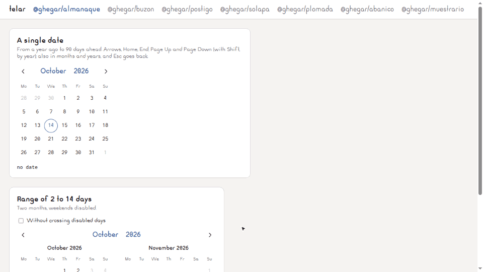

# <picture><source media="(prefers-color-scheme: dark)" srcset=".github/assets/icon-dark.svg"></picture> telar

[](LICENSE)

Headless React components, one package each: calendar, dropzone, dialog, tabs, tooltip, menu, combobox and more.



**[Live demo](https://ghegar.github.io/telar/)**

Each piece owns the behavior — state, keyboard, focus, ARIA and events — and you own every pixel: they
ship no styles and no portals, only state, prop getters and `data-*` attributes to style against. The
only inline styles are functional ones (`position: fixed`, `left`, `top` from the positioning layer).
Every piece is published on its own under `@npmegar/`, with its own version and changelog.

## Install

```bash
npm install @npmegar/almanaque
```

| Package | What it is | Depends on |
|---|---|---|
| [`@npmegar/almanaque`](packages/almanaque) | Calendar with any `Intl` locale: Monday-first weeks, timezone-free ISO dates, day/month/year views, limits and ranges | `react >= 19` |
| [`@npmegar/buzon`](packages/buzon) | File dropzone: type, size, count and duplicate validation, accumulation, rejections and previews | `react >= 19` |
| [`@npmegar/postigo`](packages/postigo) | Modal dialog: layer stack, focus trap and return, Escape and outside click for the top layer, counted scroll lock | `react >= 19` |
| [`@npmegar/lanzadera`](packages/lanzadera) | Roving focus: arrows by orientation or grid, Home/End, disabled items, typeahead | `react >= 19` |
| [`@npmegar/solapa`](packages/solapa) | Tabs: linked panels, automatic or manual activation, vertical orientation | lanzadera |
| [`@npmegar/plomada`](packages/plomada) | Floating positioning: side and alignment, flip, shift, available space, arrow, auto update | `react >= 19` |
| [`@npmegar/glosa`](packages/glosa) | Tooltip: hover and focus with delays, hoverable, Escape, aria-describedby | plomada |
| [`@npmegar/abanico`](packages/abanico) | Menu button: keyboard opening, roving focus with typeahead, disabled items, Escape and outside click | lanzadera, plomada |
| [`@npmegar/muestrario`](packages/muestrario) | Combobox: accent-insensitive filter, async loading, groups, multiple values with chips | lanzadera, plomada |

React 19 is a peer of every piece. almanaque, buzon, postigo, lanzadera and plomada export a
framework-free core from the package root and the hooks from `/react`; solapa, glosa, abanico and
muestrario are React only and export their hook from the root. Each package README has the full option
table.

## Quick start

```tsx
import { createPortal } from 'react-dom';
import { useTooltip } from '@npmegar/glosa';
import { useTabs } from '@npmegar/solapa';

const VIEWS = ['Map', 'Table'];

export function Views() {
    const tabs = useTabs({ values: VIEWS });
    const tooltip = useTooltip({ delay: 400 });
    return (
        <>
            <div {...tabs.getListProps()}>{VIEWS.map((v) => <button key={v} {...tabs.getTabProps(v)}>{v}</button>)}</div>
            {VIEWS.map((v) => <section key={v} {...tabs.getPanelProps(v)}>{v} view</section>)}
            <button {...tooltip.getTriggerProps()}>Export</button>
            {tooltip.open && createPortal(<div {...tooltip.getTooltipProps()}>PNG or PDF</div>, document.body)}
        </>
    );
}
```

## How the pieces work

| Concept | What it means |
|---|---|
| Prop getters | `getRootProps()`, `getTriggerProps()`, `getItemProps(i)`…: spread them on your elements; they carry ids, ARIA, handlers and `ref` |
| Controlled or not | Pass the value (`value`, `open`, `files`, `activeIndex`) with its callback to control it; leave it out and the piece keeps its own |
| Styling | Only through attributes: `[data-selected]`, `[data-active]`, `[data-disabled]`, `[data-state]`, `[data-side]`… |
| Portals | Yours: render floating content with `createPortal` where you want it |
| Layers | Escape goes to the topmost layer: a glosa tooltip inside a postigo dialog closes first, and any component that calls `preventDefault()` on Escape keeps it |
| Without React | The pieces with a core expose the same store (`subscribe`, `getSnapshot`) and their pure helpers |

## The pieces

Each package README has a full example, the option table and the keyboard map.

| Piece | Hook | Highlights |
|---|---|---|
| [almanaque](packages/almanaque#readme) | `useCalendar` from `/react` | Plain `YYYY-MM-DD` strings, no `Date` or time zones; ranges with `minDays`/`maxDays` and hover preview; several months side by side; APG date picker keyboard |
| [buzon](packages/buzon#readme) | `useDropzone` from `/react` | Validates what is dropped, not only what the dialog lets through; rejection codes `type`, `size`, `duplicate`, `custom`, `count`; uploading is yours |
| [postigo](packages/postigo#readme) | `useDialog` from `/react` | Stacked dialogs: Escape and outside click reach the top one, Tab stays inside, focus returns, counted scroll lock; outside the dialog it only touches `overflow` and `padding-right` on `body` and `inert` on the page |
| [lanzadera](packages/lanzadera#readme) | `useRovingFocus` from `/react` | One tab stop per group, arrows by orientation; the keyboard layer under solapa, abanico and muestrario, and for radio groups and segmented controls |
| [solapa](packages/solapa#readme) | `useTabs` | Panels linked by ids and ARIA; inactive panels get `hidden`; `activation: 'manual'` waits for Enter or Space |
| [plomada](packages/plomada#readme) | `usePosition` from `/react` | Flips, shifts back into the viewport, reports available height and arrow offset, follows the reference on scroll and resize |
| [glosa](packages/glosa#readme) | `useTooltip` | Opens on hover after `delay` (600 ms) and at once on focus, stays open while hovered, the next tooltip opens without delay |
| [abanico](packages/abanico#readme) | `useMenu` | WAI-ARIA menu button: arrows open on the first or last item, typeahead, disabled items, selection returns focus to the button |
| [muestrario](packages/muestrario#readme) | `useCombobox` | Focus stays in the input (`aria-activedescendant`), accent- and case-insensitive filter, `load(query, signal)` with debounce and abort |

## Known limitations

- Labels and messages default to English (en-US); almanaque, buzon and muestrario take `labels` and
  `locale` to replace them. almanaque weeks always start on Monday.
- buzon only guesses `[data-drag]` while dragging from the MIME types the browser exposes; extension
  rules can only be checked on drop.
- glosa ignores touch pointers, and a `disabled` button never opens its tooltip: use `aria-disabled` or a
  focusable wrapper.

## Development

```bash
npm install
npm test
npm test -- --project almanaque
npm run lint
npm run typecheck
npm run build
npm run demo
npm run e2e
```

The demo is one Vite app with a page per piece (`#almanaque`, `#buzon`, `#postigo`, `#solapa`,
`#plomada`, `#abanico`, `#muestrario`); lanzadera shows up under solapa and glosa under abanico. The e2e
suite runs Playwright against it on port 5181 and connects over CDP to a Chrome on `127.0.0.1:9222` when
one is listening.

## Contributing

Issues are welcome. Open one before sending a pull request.

## License

AGPL-3.0-only © GHEgar
